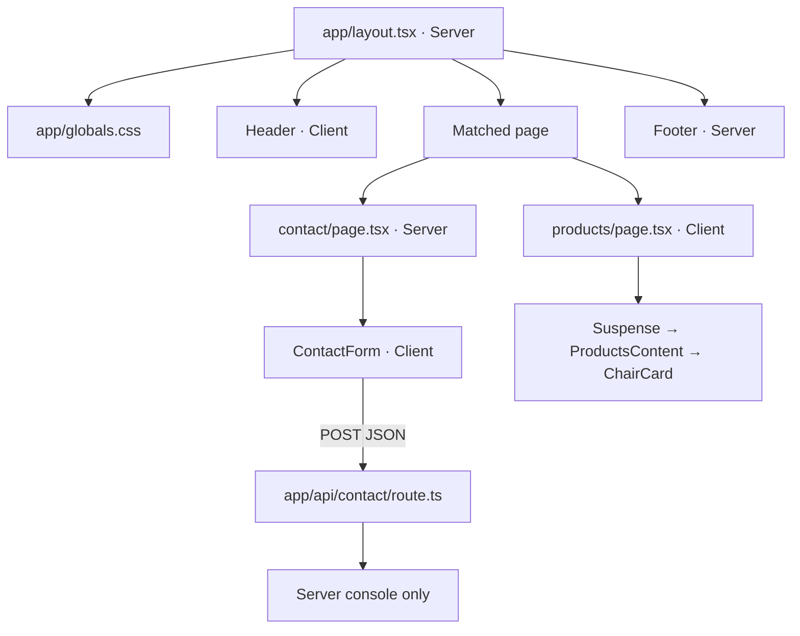

# Architecture

Verified 2026-11-07 from source. [Route inventory](routes-and-features.md) owns route details; [Data flow](data-flow.md) owns state and request contracts.

## Boundaries and dependency direction

This is a single deployable public marketing application. Layout/page imports point to shared components; shared components do not import pages or each other. App-local import inspection found no cycles; this is a small graph review, not a formal dependency analyzer run. No package workspace, backend service, service layer, provider, or authentication boundary exists.

The root layout owns HTML language, body, CSS, site metadata and Header/Footer. It does not provide a `main` landmark. Pages use top-level div/section elements. Changing layout or CSS affects every page. Local content arrays and inline helper components intentionally remain with their page under current repository rules; do not infer a historical rationale for this arrangement.

## Rendering

- Server components: root layout, Footer, contact page, about page.
- Client entries: home, products, company, services, quote, Header, ContactForm; also three unused components listed in the [registry](component-registry.md).
- A client directive does not mean an entire route is request-rendered: the successful alternate Webpack build classifies all seven pages as static, and the POST endpoint as dynamic.
- Products wraps `ProductsContent` in Suspense because it calls `useSearchParams`. Its header-only fallback is prerendered; catalogue content is client-rendered within that boundary. Preserve this distinction when evaluating indexing/loading.
- No explicit ISR interval, cache tags, revalidation calls, request-time page data, streaming data fetches, server actions, or `cacheComponents` configuration is present. `next.config.ts` contains an empty options object.
- No nested layouts, dynamic segments, route groups, middleware/proxy, route-specific loading/error/not-found files, or parallel routes. Default framework handling applies; it is not a bespoke recovery UX.

Framework evidence: installed guides under `node_modules/next/dist/docs/`: `01-app/01-getting-started/05-server-and-client-components.md`, `01-app/03-api-reference/04-functions/use-search-params.md`, and `01-app/03-api-reference/08-turbopack.md`. Read relevant local guides before version-specific code changes.

## Data, styles, infrastructure

Local arrays/JSX are the content source. URL query parameters and local React state drive the catalogue. The sole application `fetch` submits the contact form; no response is used to populate page content. Quote state never crosses a server boundary. [Data flow](data-flow.md) describes both precisely.

Global CSS imports Tailwind v4; PostCSS loads `@tailwindcss/postcss`. Styles mix utility classes and inline values. No CSS Modules, CSS-in-JS dependency, Tailwind config file, theme provider, or icon library is present. See [Design system](design-system.md).

TypeScript is strict, uses bundler resolution and root alias `@/*`. ESLint uses Next core-web-vitals/typescript presets. No environment variable reads are present in app/components. Vercel is a stated project target, not verified hosted infrastructure. No tracked CI workflow, deployment manifest, persistence, email integration, analytics, or operational monitoring is implemented.

## Architectural assessment

Strengths: shallow import graph, few runtime dependencies, explicit content ownership, server shell with isolated contact interactivity, and a query-aware catalogue Suspense boundary. Risks: broad client page boundaries for modest interactivity, repeated styles/content, unverified form success semantics, and no automated behavioral tests. Evidence, severity, confidence and next actions live only in [Known issues](known-issues.md); improvement proposals are not implemented decisions.
