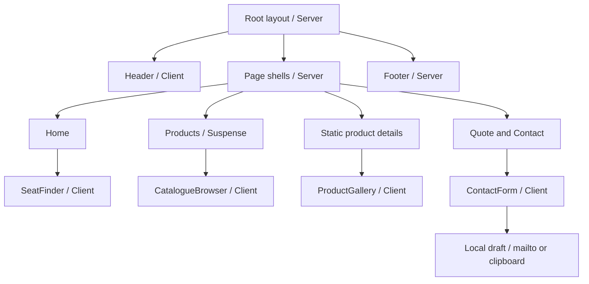

# Architecture

Source verified **2026-11-18**. One Next.js App Router application with a shared root shell, local catalogue and focused client interactions. [Routes](routes-and-features.md) owns route details; [Data flow](data-flow.md) owns state.

## Rendering boundaries

- Root layout owns global CSS, the single main landmark, skip link, metadata, Organization JSON-LD, Header and Footer. Pages must not remount the shell.
- All page entry files are Server Components. Home uses SeatFinder; products uses query-aware CatalogueBrowser inside Suspense; detail uses ProductGallery; contact/quote use ContactForm.
- `/quote` reads awaited searchParams and renders on demand to resolve selected catalogue slugs. Other fixed pages prerender; all 32 product routes use generateStaticParams with dynamicParams=false.
- ProductCard is server-safe and also imported into the catalogue client bundle. No providers, global stores, server actions, CMS or remote content fetches exist.
- ScrollReveal, ImageCarousel, PageTransition and Experience remain unmounted. No scroll-reveal wrappers run in the redesigned pages.
- The legacy POST contact endpoint is independent of the current UI. It logs only; it is not a delivery service.

## Styles and infrastructure

Tailwind v4 through PostCSS plus shared global CSS utilities/tokens. No new package, font download, CSS framework, icon library or configuration was introduced. Runtime dependencies remain Next/React/React DOM. TypeScript is strict; direct imports use `@/` or relative paths.

All mounted images use next/image and local public assets. No new remote image configuration is required. System typography avoids a font-network dependency. Content ownership stays in page-local markup and app/products/catalogue.ts.

There is no app auth, database, persistent draft store, automatic email integration, analytics or tracked deployment/CI configuration. Vercel remains the stated target; hosting was not changed. No cache tags, ISR settings or speculative next.config options were added.

The request-driven quote boundary is intentional: selected product names are validated on the server before passing to the client form. Personal enquiry fields stay local until the visitor explicitly uses an email/clipboard action. See [Security](security.md) and [decision log](decision-log.md).
